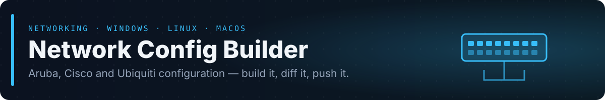

<!--
  Network Config Builder — README
  Created by Redfox using Claude
-->

<div align="center">



<br />

[](https://github.com/RafaDevpt/network-config-builder/actions/workflows/ci.yml)
[](https://github.com/RafaDevpt/network-config-builder/releases/latest)


<br /><br />

<a href="https://github.com/RafaDevpt/Personal-AI-Projects"></a>
<a href="https://github.com/RafaDevpt/network-config-builder/releases/latest"></a>

<sub>Part of <a href="https://github.com/RafaDevpt/Personal-AI-Projects"><b>Personal AI Projects</b></a> by Redfox</sub>

</div>

# 🌐 Network Config Builder

> **Switch configuration for Aruba, Cisco and Ubiquiti — build it, diff it, then push it**

---

## What it does

Configuring a floor of switches is the same twenty minutes repeated per device: the same VLANs, the same uplink trunk, the same NTP server — retyped into a different CLI syntax depending on which brand happens to be in that comms room.

Network Config Builder collapses that into one form. Describe the switch once — VLANs, ports, services, hardening — and it writes the configuration file in **Aruba AOS-CX**, **Cisco IOS**, **Ubiquiti EdgeSwitch** or **UniFi** syntax. The same voice VLAN is not written three times because the network has three brands.

Then, optionally, it connects: reads what is actually running on the device, shows the difference against what was built, and pushes — in that order, with a backup taken before any write.

---

## Modules

### 📝 The builder

A form and a live preview. Identity, management addressing, VLANs, ports, NTP/syslog/SNMP, hardening. Four starting templates for the shapes that repeat — a 48-port access switch, an office switch with voice, an AP switch — none of which carry addressing or names.

Ports accept ranges in the vendor's own notation: `1/1/1-1/1/24` configures 24 at once.

### 🔍 Validation

Runs before generation. Only things that would produce a file the device rejects, or that would cut off the person applying it, count as errors — everything else is a warning, and warnings are written into the generated file's header.

It catches the gateway outside the management subnet, the address written without a prefix, the VLAN referenced but never declared, the port name copied from another vendor, and portfast on a switch-to-switch trunk.

### 🔌 Read, compare, push

Reads the running configuration over SSH, normalises away the firmware banner and the hundreds of default lines that would otherwise swamp a diff, and answers one question: *what will this push change?*

Push is dry-run by default. The real thing requires typing the device's name.

### 📋 Inventory

Reads the switch list that already exists in somebody's spreadsheet — `.xlsx`, `.csv`, `.json` — and writes it back. A TCP reachability sweep shows what is up before any work starts.

---

## Safe by default

| Rule | In practice |
| :--- | :--- |
| **Read before writing** | The backup is the entry condition for a push, not an extra. Read fails → push does not happen. |
| **Simulate by default** | `push()` starts at dry run. Writing for real takes `--confirmar`, or typing the device name in the GUI. |
| **No passwords, ever** | Generated files carry `<DEFINIR-PALAVRA-PASSE>`. Credentials live in memory for the session and are never written to disk. |
| **One red button** | Generate, save and compare are neutral. The only red control in the application is the one that writes to a switch. |

The generation half depends on **nothing but the standard library** — deliberately, so it runs on a domain machine where installing packages is blocked by policy.

---

## About UniFi

A UniFi switch runs the same CLI as an EdgeSwitch underneath, but its configuration belongs to the **controller**. Anything written over SSH disappears at the next provisioning run — a controller change, a re-adoption, a restart.

It is supported anyway, because reading a UniFi is useful: inventory, diagnosis, recording the state before touching anything. But every file generated for UniFi carries a warning at the top, gets no `write memory`, and needs an extra confirmation to push.

The right place to configure a UniFi is the controller. The tool says so rather than pretending otherwise.

---

## Current state

- **216 tests**, none of which opens a network connection
- Four platform generators, each covering identity, VLANs, SVIs, ports, services and hardening
- GUI and headless CLI, with distinct exit codes for the scheduler
- Bilingual source — every module, class and function documented in PT-PT and EN-UK

---

## Installation

Double-click **`Windows\EXECUTAR.bat`**. First run builds the environment; after that it starts straight away. No elevation required — this tool reads nothing from the local machine.

```bash
python -m venv .venv
.venv\Scripts\activate
pip install -r requirements.txt
python -m netconfig
```

---

## Usage

```bash
python -m netconfig                                              # GUI
python -m netconfig modelo acesso --saida piso1.json             # starting profile
python -m netconfig gerar piso1.json --saida SW-PISO1.cfg        # generate
python -m netconfig backup --todos                               # back up the fleet
python -m netconfig comparar piso1.json --equipamento SW-01      # diff
python -m netconfig enviar piso1.json --equipamento SW-01 --confirmar
```

Full documentation, including the per-vendor quirks that each generator exists to handle, in [`Network-Config-Builder/README.md`](Network-Config-Builder/README.md).

---

## Known limits

- **No Aruba AOS-S (ProCurve).** The 2530/2540/2930 line is a different syntax entirely — effectively a fifth platform, not a variation of AOS-CX.
- **No configuration removal.** A push adds and changes. Deciding what to take away belongs to whoever knows the network.
- **No model detection.** Where a command depends on the model rather than the platform — IOS's `switchport trunk encapsulation dot1q` — it is emitted commented, with the reason beside it.
- **No port-notation translation between vendors.** Flagged with a warning, and left alone.

---

## Licence

MIT — see [`LICENSE`](LICENSE).

<sub>Created by Redfox using Claude</sub>


## 🐳 Docker & Terraform

The graphical interface stays a desktop app: a container has no screen. Docker runs the command line, which is the part worth automating.

Files: [`Network-Config-Builder/Linux/Dockerfile`](Network-Config-Builder/Linux/Dockerfile) · [`Network-Config-Builder/Linux/terraform/`](Network-Config-Builder/Linux/terraform/)

### Docker

```bash
cd Network-Config-Builder/Linux
docker build -t local/network-config-builder .
docker run --rm local/network-config-builder --help
```

Everything the app reads or writes lives in `/dados`; a host folder is mounted there and the container runs as the invoking user (`--user`), so the files it writes belong to that user.

Write a starting profile:

```bash
docker run --rm --user "$(id -u):$(id -g)" -v "$PWD:/dados" local/network-config-builder modelo acesso --saida perfil.json
```

Generate the configuration file:

```bash
docker run --rm --user "$(id -u):$(id -g)" -v "$PWD:/dados" local/network-config-builder gerar perfil.json --saida switch.cfg
```

Back up a device (asks for the password):

```bash
docker run --rm -it --user "$(id -u):$(id -g)" --network host -v "$PWD:/dados" local/network-config-builder --inventario inventario.xlsx backup --equipamento SW-EXEMPLO-01
```

### Terraform

Builds the image and creates a container with the same hardening (read-only filesystem, no capabilities, unprivileged user).

```bash
cd Network-Config-Builder/Linux/terraform
mkdir -p dados
terraform init
terraform apply -var "pasta_dados=./dados" -var "utilizador=$(id -u):$(id -g)"
docker logs network-config-builder            # output
docker start -a network-config-builder        # run again with the same settings
terraform destroy
```

Change what it runs with `-var 'comando=[...]'` (default: `["gerar", "perfil.json", "--saida", "switch.cfg"]`). Secrets go in `TF_VAR_ambiente`, never in the `.tf` files.
